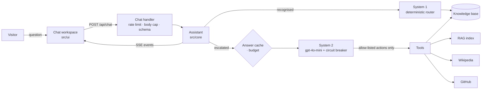

# marcio-alves-portfolio

Personal portfolio with an AI assistant that answers questions about my work,
grounded in documented sources and unable to invent what it does not know.

## Requirements

- Node >= 24
- pnpm 10 (`corepack enable`)

## Getting started

```bash
cp .env.example .env.local
pnpm install
pnpm dev
```

## Scripts

| Command                    | Purpose                                              |
| -------------------------- | ---------------------------------------------------- |
| `pnpm dev`                 | Development server                                   |
| `pnpm build`               | Production build                                     |
| `pnpm typecheck`           | Route types, then TypeScript, no emit                |
| `pnpm lint`                | ESLint, warnings treated as failures                 |
| `pnpm lint:fix`            | ESLint with autofix                                  |
| `pnpm format`              | Prettier, write                                      |
| `pnpm format:check`        | Prettier, verify only                                |
| `pnpm boundaries`          | Module-boundary rules                                |
| `pnpm test`                | Unit and integration tests (Vitest)                  |
| `pnpm test:motion`         | Motion and reduced-motion checks in Chromium         |
| `pnpm test:coverage`       | The tests, with a coverage report in `coverage/`     |
| `pnpm test:e2e`            | Critical journeys in Chromium (Playwright)           |
| `pnpm test:a11y`           | Axe, security headers and SEO (part of `test:e2e`)   |
| `pnpm lighthouse`          | Lighthouse budgets on a production build             |
| `pnpm rag:build`           | Re-embed the knowledge corpus (needs the key)        |
| `pnpm notes:build`         | Split the knowledge-base document into passages      |
| `pnpm eval:assistant`      | Grade the assistant end to end (needs the key)       |
| `pnpm fidelity`            | Compare every artboard with its page, pixel by pixel |
| `pnpm fidelity:references` | Re-render the design's artboards as references       |
| `pnpm verify`              | Every gate, in the order CI runs them                |

## Quality gates

Four checks guard the repository. Each one runs locally through a git hook and
again in CI, so a failure surfaces on the machine that caused it.

**ESLint** uses type-aware rules (`strictTypeChecked`), which read the type
checker rather than the syntax tree. That is what catches a floating promise or
an unnecessary condition — defects a syntax-only linter cannot see. Warnings
fail the run: a warning nobody must act on is noise.

**Prettier** owns formatting outright; ESLint's formatting rules are switched
off so the two can never disagree. The Tailwind plugin sorts every class list
into canonical order, which keeps diffs about behaviour instead of class order.

**dependency-cruiser** enforces the architecture. `src/core` may not import
Next, React, a vendor SDK, or anything from an outer layer, and inside it the
knowledge base never imports the assistant. `src/ui` never reaches the
adapters, the composition root or `env`; adapters never reach the routes, the
UI or the root; routes reach adapters only through the root. Cycles and
unresolvable imports are rejected. Zod is the single allowed dependency inside
`src/core`, because the assistant's tool contracts are Zod schemas and those
schemas are policy, not an adapter. Each boundary rule has a fixture under
`src/architecture/fixtures` that breaks it, and a test proves the rule reports
it.

`src/composition-root.ts` and `src/env.ts` import `server-only`, so a client
component that reaches either fails `next build`.

**commitlint** requires Conventional Commits whose subject ends with its task
key, for example `feat(ui): add the composer (POR-10)`. The type drives the
automated version bump, so the format is load-bearing.

Hooks are installed by `pnpm install` (the `prepare` script). `pre-commit`
formats and lints what is staged, `commit-msg` validates the message, and
`pre-push` runs typecheck, lint and the boundary rules. Never bypass them with
`--no-verify`: fix the gate or fix what the gate found.

Coverage is a gate only where a drop means lost protection. `src/core` (the
assistant's policy) and `src/infrastructure` (the adapters) are tested almost
completely, so `vitest.config.mts` sets lines, branches and functions
thresholds for each, two points below the measured baseline rounded down. CI
runs `pnpm test:coverage` and fails when either falls below them, so deleting
or skipping tests there is caught, while the margin keeps the gate from
rewarding tests written only to move the number. The rest of `src` stays a
diagnostic: `pnpm test:coverage` still shows which code no test reaches.
Lowering a threshold needs a stated reason in the pull request, with the new
measurement. A change that moves or renames either folder updates the globs in
`vitest.config.mts` too: a glob that matches nothing counts as fully covered.

## Continuous integration

`.github/workflows/ci.yml` runs on every pull request and every push to `main`.
The static gates fan out from one matrix job, so adding a gate is one list
entry rather than a copied job. `build`, `e2e`, and `commits` on pull requests,
run alongside them. A final `ci` job summarises the rest, which lets branch
protection require one check instead of a list that has to be edited whenever a
job is added.

Setup is a composite action in `.github/actions/setup`: pnpm, Node from
`.nvmrc`, and a cached, frozen-lockfile install. Third-party actions are pinned
to commit SHAs, not tags — a tag can be moved to point at different code.

`a11y` and `lhci` run the browser checks described under
[Accessibility, performance and search](#accessibility-performance-and-search),
each against its own production build.

The build job is given no secrets, which is the check that environment
variables stay lazily validated: a build that needs a runtime credential fails
here.

The commit-message rule is enforced twice on purpose. The `commit-msg` hook
only protects whoever installed it; the `commits` job is the one nobody can
skip.

## End-to-end tests

`pnpm test:e2e` walks the journeys a visitor cannot be let down on, in
Chromium, against a production build: asking a suggested question and watching
the answer stream in with its timeline, metrics, sources, actions and
follow-ups, then following up; opening a topic page and coming back to the
home conversation intact; a question the record does not
document; a failed answer and its retry; and the navigation drawer on a phone.
Everything else is proven lower, in Vitest, where it is faster and cannot
flake.

Playwright builds the site and starts it on port 3100 itself, fresh for every
run — the request limit is in memory, so a reused server would carry one run's
requests into the next. It starts it with `OPENAI_API_KEY` empty, which the app
reads as "not set" and which keeps `.env.local` from filling it in, so every
answer comes from the deterministic fast path; a global setup reads
`/api/health` and refuses to run if the model is enabled anyway. The network is
intercepted in two places only, and the server still answers: one test fails a
request once to reach the error, and one holds a request at the browser before
letting it through, because a fast-path answer arrives too quickly to see the
in-flight state otherwise.

Locally, install the browser once with `pnpm exec playwright install chromium`.
In CI the `e2e` job caches the browsers keyed by the Playwright version, retries
a failed test twice with a trace of the retry, and keeps the report and traces
as an artifact when a run fails. There are no pixel comparisons here: fonts
render differently on GitHub's runners, so visual fidelity stays with
`pnpm fidelity`.

## Knowledge base

`src/core/knowledge` is the single source of truth for every fact the site and
the assistant present. Two layers live side by side on each role: condensed
fields that shape the interface, and `highlights` — the resume's bullet points
verbatim — which are the factual record retrieval searches. Where the design's
copy and the resume disagree, the resume wins.

Identifiers are literal unions, so a role citing a metric that does not exist
fails to compile. Tests cover what the type system cannot: chronology, one
record per id, and which roles overlapped.

Nothing is inferred. The resume states a country but not a city, so the city
is `null` and the assistant says it is not documented rather than guessing.

### Retrieval

The knowledge base is also flattened into categorized passages — profile,
experience, skills, education, languages, certifications, projects,
principles — one per resume statement, each naming its company and role. They
are embedded with `text-embedding-3-small` at 512 dimensions into
`src/infrastructure/retrieval/knowledge-index.json`, which is committed.

The index is built offline with `pnpm rag:build`, never during a build, because
the build must not need a secret; at runtime only the question is embedded.
The index records a hash of the corpus it came from, and a test fails the
moment the knowledge base changes without the index being rebuilt.

Marcio's knowledge-base document, `src/core/knowledge/data/knowledge-base.md`,
adds a `notes` category: how he works, system design, AI-assisted engineering,
studies, his own products, goals and interests. `pnpm notes:build` (run first
by `pnpm rag:build`) splits it into `notes.json`, one passage per subsection
and per FAQ question; its closing sections about the document itself are left
out. Its evidence tags (`[CV-2026]`, `[RELATO]`, `[RELATO/ESTUDO]`, `[PORTFÓLIO]`) stay in the
text, and the system prompt tells the model what each one allows it to claim.
A search with no category keeps its whole limit for résumé passages and adds
at most three notes, so the long Portuguese notes never crowd the résumé out.
To update the base, replace the document and run `pnpm rag:build`.

A technology only the notes mention comes back from `getTechnologyEvidence` as
"reported in his notes", with the paragraphs and their tags, and the fast path
leaves it to the model instead of answering "not documented" from the résumé
alone; coursework still outranks it. A "not documented" decline the model makes
before any search is replaced by a search of the whole record for the visitor's
question, and a search limited to a category that finds nothing widens to the
whole record.

## Chat endpoint

`POST /api/chat` takes `{ message, history, context }` and answers as
Server-Sent Events in the contract of `src/core/assistant/assistant-event.ts`.
Everything in the request is untrusted: the body is read in pieces and cut off
at 32 KB (a `Content-Length` can lie), then validated by a strict schema —
1,200 characters per question, 24 turns of history at most, no unknown fields.

The stream is pulled one event at a time, so nothing is generated faster than
the visitor reads it; when they leave, the stream is cancelled and the
request's abort signal ends the model call behind it.

### Spending

The model is the only part that costs money, so it is fenced in layers.
Each client may send 40 requests in any ten minutes (429 with `Retry-After`
past that) and start 15 model answers; a visitor over the second limit gets a
free answer explaining it, with suggestions the fast path answers. A
context-free question already answered is replayed from cache, at no cost and
without counting against the visitor. Each instance also stops calling the
model after about two million tokens a UTC day. Each of these numbers is a
default a deployment can change through its environment (see `.env.example`).

All of that is in memory, so per instance: defence in depth, not a quota. The
hard ceiling is the monthly budget set on the OpenAI project, which is where
the spend is actually capped.

## Design tokens

`src/app/globals.css` is the whole visual vocabulary of the approved design,
"White & Ice" — white and ice neutrals, ink as the only accent, hairlines
instead of shadows — declared as Tailwind v4 `@theme` variables: surfaces,
ink, lines, the accent, a half-pixel type scale named for its values
(`text-13.5` is 13.5px), line heights, letter spacing, radii, hairlines and
shadows, one easing curve, two durations, the keyframes, and the layout
widths. Every visual decision is therefore a utility over a token —
`bg-ice`, `text-ink-muted`, `shadow-ring-strong`, `duration-fast`.

The corollary matters more than the list: **a value that cannot be written as
a utility is a missing token, not a licence to write CSS.** The only raw CSS is
what no utility can reach: the root line height (the design keeps the
browser's `normal`), the global focus ring, a text-rendering hint, the
`prefers-reduced-motion` collapse, and four tiny `@utility` rules.
`cn()` registers the custom tokens with tailwind-merge — which would otherwise
read `text-13` as a colour and drop it — and a test keeps that list in step
with the stylesheet.

`--color-ink-faint` is for icons, rules and decoration only; text uses
`--color-ink-muted`, which holds 5.5:1 or better on every surface.

Inter, Inter Tight and Geist Mono come from `next/font/google`: the same files
the design loads, downloaded at build and served from this site.

## Design fidelity

The design is the specification, and it is checked by pixels, not by eye.
`pnpm fidelity:references` renders every artboard of the design (served
locally with its own runtime) at its canvas size into `fidelity/reference/`.
`pnpm fidelity`, with `pnpm dev` running, renders each board's counterpart —
a development-only page under `/workbench/fidelity/` built from the real
components and the real record — at the same size, compares the two pixel by
pixel with anti-aliasing left out, and requires 99.9% of pixels to match on
every board. The full-screen states (a streaming answer, a failure, a long
follow-up…) are rebuilt the way the prototype builds them: real fast-path
answers replayed through the conversation's transitions.

A board production departs from on purpose carries a `departure` in
`scripts/fidelity/boards.ts` saying why. It is still measured and reported as
`DEPART`, but does not fail the gate. The one today is StateTopic: a topic is
its own page (`/experience`, `/skills`…), so its record follows the
introduction the artboard shows alone.

`pnpm fidelity:live` checks the boards production renders as they are — the
welcome screen on a desktop and on a phone — against the live site, so a
deployment that differs from what was built locally is caught too. It found
one: a build that reused a stale stylesheet (see `next.config.ts`).

The references take three deliberate liberties with the prototype, each
explained where it is made: they omit its "Preview with scripted answers"
notice, they run its logic with the production contact data (GitHub linked,
the résumé at its real address), and they undo two of its timing artefacts — a
composer sized before its font loaded, and a conversation scrolled while
still rendering in.

A board production deliberately no longer matches carries a `departure` in
`scripts/fidelity/boards.ts` saying why. It is still measured and reported as
`DEPART`, but it does not fail the gate. There are two: `StateTopic`, because
a topic is now a page of its own that shows its part of the record beneath the
introduction (POR-34), and `AssistantMessage`, because an answer cites the
résumé once as "Resume" rather than once per section (POR-36).

## Topic pages

The overview is the home page; every other topic in the sidebar is a page of
its own at `/<topic>` (`/experience`, `/skills`, `/projects`, `/achievements`,
`/philosophy`, `/education`). Each opens without the current conversation, on
its introduction and its part of the record — the timeline, the skill groups,
the project cards, the metrics, the principles, the languages and courses —
built locally from `src/core/knowledge`, never by the model, and prerendered
at build. A question asked there is answered beneath it, in that page's own
conversation.

Every page's conversation is held in `ConversationsProvider`, above the pages,
so leaving a page and coming back finds it as it was, an answer still streaming
included, for as long as the tab is open. "New conversation" starts the current
page over: the welcome screen on the home page, the introduction on a topic.
Any other address answers 404: `ensureStatic = 'navigation'` keeps an unknown
topic from being served the prerendered shell, with its 200, while it renders.

## Accessibility, performance and search

`pnpm test:a11y` builds the site, starts it and checks it in Chromium with
Playwright (`playwright.a11y.config.ts`, specs in `e2e/`):

- **Accessibility** — axe scans the home page against WCAG 2.1 A and AA in
  its key states: the welcome screen, a fast-path answer with a timeline and
  metrics, a failed answer, and the navigation drawer open on a 390px phone.
  Each state is reached by clicking, as a visitor would; only the failure is
  forced, at the network. Reduced motion is on, so contrast is never measured
  halfway through a fade. Zero violations are allowed.
- **Security** — the headers every route is served with, and the content
  policy as a browser enforces it: asking a question, streaming the answer and
  fetching the social image raise no violation and no console error, while a
  script from another origin is refused and another site cannot frame the page
  (with a control showing the same frame renders once the headers are gone).
- **Search** — title, description, canonical, Open Graph and Twitter tags, the
  JSON-LD `Person`, the 1200×630 social image, the tab icon, `robots.txt` and
  the sitemap, as a crawler receives them.

`pnpm lighthouse` (after `pnpm build`) runs Lighthouse CI three times on the
home page with its default mobile emulation and fails on any budget in
`lighthouserc.json`: performance ≥ 0.9, accessibility and SEO 1,
best practices ≥ 0.95, LCP ≤ 3.5 s, TBT ≤ 300 ms, CLS ≤ 0.02. Each assertion
takes the best of the three runs, Lighthouse CI's default, so runner noise
does not fail a pull request. Measured locally the page scores 0.95 / 1 / 1 /
1, with LCP 2.9 s, TBT 10–35 ms and no layout shift; with the CPU slowed a
further 3×, as on a slow runner, TBT reaches 205 ms and performance drops to
0.90–0.95, which is where the budgets leave their headroom. LCP is Lighthouse's
simulation of a slow phone, not a measurement: the paint it was observed at,
0.9 s, came after every script had loaded, so the simulation charges all of
them to it.

### Security headers

`next.config.ts` sends, on every route, a Content-Security-Policy,
`Strict-Transport-Security` (two years, subdomains included, not preloaded),
`X-Content-Type-Options: nosniff`, `X-Frame-Options: DENY` with
`frame-ancestors 'none'`, `Referrer-Policy: strict-origin-when-cross-origin`
and a `Permissions-Policy` that turns off camera, microphone, geolocation,
payment, USB and the Topics API. `X-Powered-By` is off.

The policy is static, not a per-request nonce, because the home page is a
prerendered shell and a nonce cannot reach one. Every source is this origin
only. Two allowances remain: inline scripts, because the App Router streams
its payload through them, and inline style _attributes_, because a
server-rendered `style={{ '--var': value }}` is how a dynamic value reaches a
utility here; style elements are not allowed. Development additionally allows
`eval` and inline style elements, which React and the dev server need.

### Search and sharing

The root layout sets the title, description and Open Graph and Twitter tags;
`metadataBase` is `siteUrl()`, so every absolute URL follows the canonical
origin. Each topic page sets its own title, description and canonical, and the
sitemap lists them all. The home page adds its canonical and a JSON-LD `Person` built from
`src/core/knowledge` — name, title, summary, LinkedIn and GitHub, and every
documented skill, never the coursework. `robots.ts` keeps crawlers out of
`/workbench` and `/api` and points to `sitemap.ts`.

`opengraph-image.tsx` and `icon.tsx` are generated once at build with
`next/og`, in the design's ink on white and Inter Tight, read as WOFF from
`@fontsource/inter-tight` because the image renderer cannot read the WOFF2
next/font serves the page. The renderer cannot read the stylesheet either, so
`brand-colors.ts` carries the few colours it uses and a test keeps them equal
to the tokens.

## Architecture

Source dependencies point inward. `src/core` is plain TypeScript: it never
imports from Next.js, React, the OpenAI SDK or any other outer layer. This is
checked by `pnpm boundaries`, not left to discipline.

```
src/
  app/                  Next.js routes: the page, /api/chat, /api/health, metadata
  core/                 Domain and policy, framework-free
    assistant/          Streaming contract, both answer paths, tools, ports
    conversation/       The conversation as pure transitions
    knowledge/          Career records, each with its source
  infrastructure/       Adapters: OpenAI, retrieval, Wikipedia, GitHub,
                        resilience, budgets, rate limits, logging
  ui/                   Presentational components over the design tokens
  composition-root.ts   The single place adapters are bound to ports
```

A question, end to end:



The assistant reaches data only through an allow-list of named actions. It is
never handed the knowledge base itself, and a question no action covers is
answered as undocumented rather than guessed.

### Two paths to an answer

**System 1** (`src/core/assistant/system1`) is a deterministic router over the
question. What it recognizes with certainty — every question the interface
suggests, the refusals, and technologies weighed against the record — it
answers straight from the knowledge base, instantly and without a model call.
What it is unsure of, it escalates instead of guessing: low-confidence
questions, definitions ("what is TypeScript?"), comparisons, questions naming
two companies, and anything long enough to carry several asks.

**System 2** (`src/core/assistant/system2`) is `gpt-4o-mini` acting only
through the allow-listed actions, for everything else — including any
question not written in English, since System 1's answers are, and requests
to do something (write code, a poem) rather than to learn about Marcio. The
loop is bounded: four rounds at most, the last one forced to write rather than
call another action, six actions per round run concurrently, 700 output tokens
a round. A circuit breaker stops calling the model after three consecutive
failures. Both paths produce the same response shape, so the interface never
knows which one answered, and if the model is unavailable — no key, an open
circuit, a failure before it said anything — System 1 still answers
everything it recognizes and says plainly what it cannot.

A test walks the whole suggestion graph — every topic question, then every
follow-up each answer offers, recursively — and requires the fast path to
answer all of it, so the interface can never suggest a question the assistant
cannot handle.

### Evaluation

`pnpm eval:assistant` runs a corpus of conversations
(`scripts/evaluation/cases.ts`) — career facts, technologies, companies,
profiles, location, undocumented details, off-topic requests, injection
attempts, follow-ups and other languages — through the production wiring. Each
answer's prose goes to an independent judge, a stronger model than the one
answering, together with the exact evidence the assistant had: the actions the
model ran and what they returned, or the knowledge base for the fast path. The
judge must back every claim with a passage it copies from that evidence, and
the script checks that the passage is really there; a claim without one is
re-checked once with only the evidence in view, then reported. Before grading,
the judge is calibrated on answers with planted fabrications and the run
aborts if it misses one. Deterministic checks cover the rest: which path
answered, refusals citing no source, the reply language, required and
forbidden phrases. It spends real tokens and needs the key, so it runs
locally rather than in CI.

## Deployment

Hosted on Vercel at **[marciomariani.dev](https://marciomariani.dev)**, built
from `main`. Every pull request gets its own preview deployment, which is what
the manual test steps in a pull request description point at.

The canonical origin comes from `siteUrl()` in `src/env.ts`: an explicit
`SITE_URL` wins, otherwise Vercel's production domain, otherwise localhost.
Previews therefore declare the production domain as canonical, so search
engines never index a preview URL as a second copy of the site. The value is
fixed when a deployment builds, so after attaching or changing a custom domain,
redeploy production for the canonical to follow. It is resolved
apart from the server secrets on purpose — page metadata needs it at build
time, and the build must never need a secret.

Nothing about the build is configured in this repository, because nothing needs
to be: Vercel detects Next.js, reads pnpm from the lockfile, and takes the Node
major from `engines.node` in `package.json`. That field is `24.x` rather than an
open range — the documented form Vercel resolves, and the honest one for a
project that pins every other version.

Environment variables are set in the Vercel project, never committed.
`.env.example` is the list: the secrets, the canonical origin, and the
operational settings (the chat model, the OpenAI timeout and the limits
above), each with a default, so a deployment only sets what it changes. An
invalid number fails the first request loudly instead of silently disabling a
limit. The embedding model is not among them: the committed index was built
with it. `OPENAI_API_KEY` is server-side only: a model
credential behind a `NEXT_PUBLIC_` prefix would be readable by every visitor.

## Observability

Server code logs through `src/infrastructure/logging/logger.ts`: one JSON
object per line, `level`, `event` and `time` first, then flat primitive
fields. Information goes to stdout, warnings and errors to stderr, which is
what Vercel's log view parses and filters on. `src/core` never logs; it reports
through callbacks the composition root turns into log lines.

| Event                    | Level | When                                                                                                                                                                  |
| ------------------------ | ----- | --------------------------------------------------------------------------------------------------------------------------------------------------------------------- |
| `chat.answered`          | info  | Every question answered: `path` (`fast`/`model`), `outcome` (`answered`, `cached`, `unavailable`, `paced`, `failed`, `interrupted`), `intent`, `durationMs`, `client` |
| `chat.rate_limited`      | warn  | A request turned away with 429                                                                                                                                        |
| `assistant.failed`       | error | The model, or the stream behind an answer, threw                                                                                                                      |
| `model.circuit_opened`   | warn  | The circuit breaker opened (and again each time a trial call fails)                                                                                                   |
| `model.circuit_closed`   | info  | A trial call succeeded and the model is back                                                                                                                          |
| `model.budget_exhausted` | warn  | The instance spent its daily token budget                                                                                                                             |
| `request.failed`         | error | Any uncaught server error (`src/instrumentation.ts`), with the `digest` the error page shows                                                                          |

The visitor's question and IP address are never logged. `client` is an HMAC of
the address under a key generated in memory per instance: it follows one
visitor across lines of that instance, but cannot be reversed by hashing every
IPv4 address, which an unkeyed hash could.

`GET /api/health` answers `Cache-Control: no-store` JSON:

```json
{
  "status": "ok",
  "version": null,
  "commit": "fa1eade",
  "environment": "production",
  "model": "enabled",
  "circuit": "closed"
}
```

`model` says only whether `OPENAI_API_KEY` is configured, never its value, and
`circuit` is `closed`, `open` or `half-open` (`null` without a model). `status`
stays `ok` while the circuit is open, because the site still answers from the
fast path.

`commit` is the source of truth for which build is live: Vercel sets
`VERCEL_GIT_COMMIT_SHA` on every git deployment. The release tag cannot be
known at build time — semantic-release cuts it in CI after the gates pass,
while Vercel is already building the same commit, and Vercel exposes no tag
variable. `version` is therefore `RELEASE_VERSION` when a deployment sets one
and `null` otherwise; the tag for a commit is on the Releases page.

`src/app/error.tsx`, `global-error.tsx` and `not-found.tsx` say what failed
and what to do — try again, or go home — and show the error's digest, which
matches the `request.failed` line.

## Versioning

Versions are derived from commit history by semantic-release, which runs on
`main` only after the `ci` job has passed — a broken `main` is never tagged.
`fix:` moves the patch, `feat:` the minor, and a `BREAKING CHANGE:` footer the
major.

A release is a git tag plus a GitHub Release with generated notes. There is no
`CHANGELOG.md` and nothing is committed back to `main`: the Releases page
already renders that history linked to its commits, and writing a file back
would mean a bot commit on every release — one that would have to be exempted
from this project's own commit rules to get through.

`version` in `package.json` stays at `0.0.0-semantically-released` on purpose.
Nothing reads it, the site is not published to a registry, and a number
sitting in a file is a number somebody eventually edits. **Never bump it by
hand.**

## Decisions

The choices worth explaining — and what each one costs — are recorded as
architecture decision records in [`docs/adr`](docs/adr/README.md).

## Contributing

How to set up, the conventions, and the gates every change passes:
[CONTRIBUTING.md](CONTRIBUTING.md).
